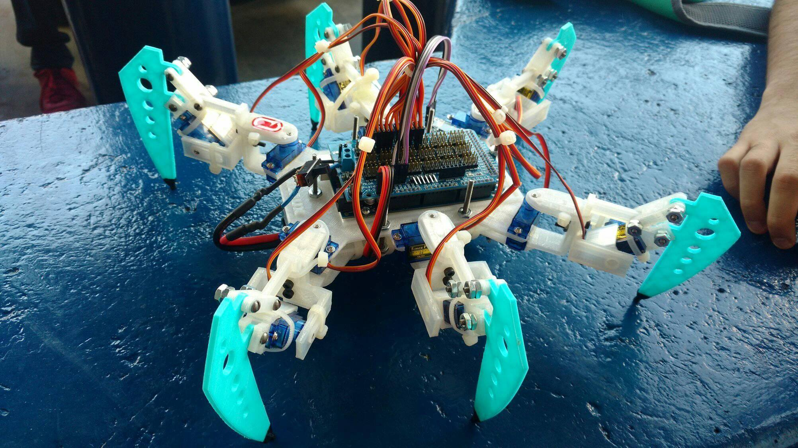

# Arduino Robotic Hexapod

A fully autonomous and Bluetooth-controlled hexapedal robot built with an Arduino Mega, 12 servomotors, an ultrasonic distance sensor, and a custom 3D-printed frame.



## Table of Contents

- [Overview](#overview)
- [Features](#features)
- [Hardware Components](#hardware-components)
- [Software](#software)
- [Project Structure](#project-structure)
- [How It Works](#how-it-works)
- [Controls](#controls)
- [Getting Started](#getting-started)

---

## Overview

This repository is a re-upload of an old college project of myself which contains the firmware and documentation for a 6-legged (hexapod) robot driven by an Arduino Mega microcontroller. The robot is controlled via a Bluetooth module (e.g., HC-05 / HC-06) from a smartphone or similar device, and it is capable of forward, backward, left, and right movements using coordinated leg algorithms. In addition, an HC-SR04 ultrasonic sensor mounted on the chassis provides basic obstacle detection: the robot will automatically stop when an obstacle is detected within a proximity of 30 cm while moving forward.

---

## Features

- **6-legged (hexapedal) locomotion** with coordinated gait using two alternating leg groups (Tripod-style).
- **Bluetooth remote control** via Serial commands from a mobile app.
- **Ultrasonic obstacle avoidance** — stops when an object is within 30 cm.
- **Forward, backward, left, and right movements** driven by synchronized multi-servo gait algorithms.
- **Open-source firmware** — released under the GPL v3 license.

---

## Hardware Components

| Component | Quantity | Description |
|---|---:|---|
| Arduino Mega | 1 | Main control board (ATmega2560) |
| Arduino Servo Shield | 1 | A shield to make it easier to connect all the servos |
| Continuous / Rotary Servomotors | 12 | Two per leg (vertical lift + lateral swing), 2 degrees of freedom per leg |
| HC-SR04 Ultrasonic Sensor | 1 | Distance sensing (trig → Pin 48, echo → Pin 49) |
| Bluetooth Module (e.g. HC-05 / HC-06) | 1 | Wireless Serial communication (TX/RX on Serial, 9600 baud) |
| Power Supply(s) | 1+ | Can use a separate regulated supply for servos |
| 3D-printed frame & leg mechanisms | 1 set | Since this project was done long time ago, I cannot find where I got the .STL files from, once found I'll update this README |

### Pin Mapping

| Servo | Pin | Leg |
|---:|:---:|---:|
| Servo 1 | 2 | Leg 1 — lateral left |
| Servo 2 | 3 | Leg 1 — vertical |
| Servo 3 | 4 | Leg 2 — lateral right |
| Servo 4 | 5 | Leg 2 — vertical |
| Servo 5 | 6 | Leg 3 — lateral left |
| Servo 6 | 7 | Leg 3 — vertical |
| Servo 7 | 8 | Leg 4 — lateral right |
| Servo 8 | 9 | Leg 4 — vertical |
| Servo 9 | 10 | Leg 5 — lateral left |
| Servo 10 | 11 | Leg 5 — vertical |
| Servo 11 | 12 | Leg 6 — lateral right |
| Servo 12 | 13 | Leg 6 — vertical |
| Ultrasonic Trig | 48 | — |
| Ultrasonic Echo | 49 | — |

---

## Software

- **IDE:** Arduino IDE (C/C++ for AVR)
- **Libraries:** Built-in `<Servo.h>` (standard Arduino library)
- **Baud rate:** 9600 baud (Serial / Bluetooth)

---

## Project Structure

```
arduinoRoboticHexapod/
├── LICENSE           GNU General Public License v3
└── Movimiento/
    └── Movimiento.ino    Main Arduino sketch (firmware)
```

- **`Movimiento/Movimiento.ino`** — The complete firmware. Controls all 12 servos, reads the ultrasonic sensor via pins 48/49, and processes Bluetooth commands on the Serial port.

---

## How It Works

### Locomotion Gait

The robot uses a **two-group (tripod-style) gait** where the six legs are split into alternating sets:

- **Group 1 (legs 1, 4, 5)** and **Group 2 (legs 2, 3, 6)** support the robot body alternately.

Each movement cycle (e.g., `adelante()` / forward) follows these phases:

1. **Lift** both groups vertically (servos rise).
2. **Shift** laterally (servos swing legs forward/sideways).
3. **Place** Group 1 down, then **lift** Group 2.
4. **Shift** Group 2 laterally.
5. **Place** Group 2 down.

This alternating cycle produces smooth walking motion. The same principles apply to backward and turning movements, with direction reversed for appropriate servos.

### Obstacle Avoidance

In the `loop()`, when moving forward (`case 'a'`), the ultrasonic sensor is triggered via `recorrido()` to measure distance. If `distancia <= 30` cm, the robot calls `alto()` (stop) and waits 750 ms before resuming.

### Bluetooth Communication

The Arduino listens on `Serial` for single-character commands. Upon receipt, the state variable is updated and the corresponding movement function is executed.

---

## Controls

| Command | Action | Description |
|:---:|:---:|---|
| `a` | Forward | Move ahead; stops if obstacle ≤ 30 cm |
| `b` | Left | Turn / strafe left |
| `c` | Stop | Stationary (all servos return to neutral 90°) |
| `d` | Right | Turn / strafe right |
| `e` | Backward | Move in reverse |

> **Tip:** Send a single character via any Bluetooth Serial terminal app on your phone (e.g., "Serial Bluetooth Terminal" on Android or "LightBlue" on iOS).
